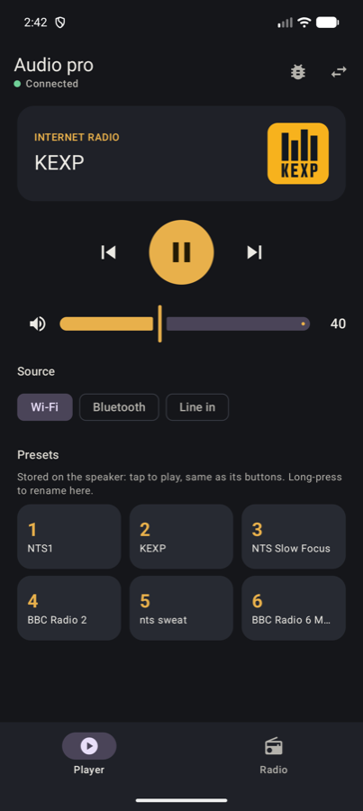
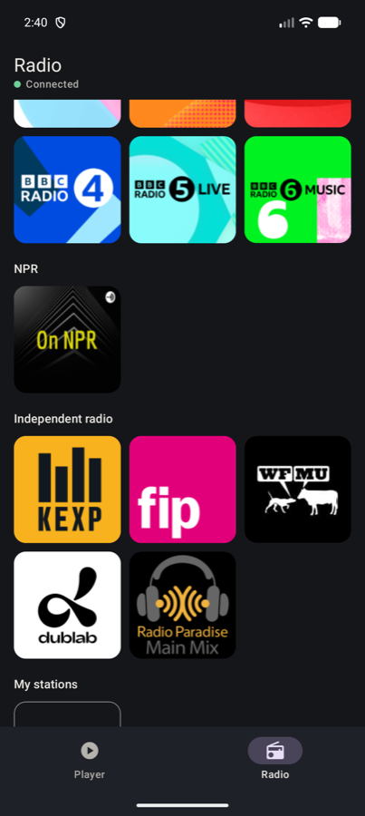

# Audio Pro Player

A free Android app that controls Audio Pro Wi‑Fi speakers directly over your home network. Use it instead of the Audio Pro app once your speaker is on your Wi‑Fi. It needs no account and no cloud service.

It was built for an Audio Pro **ADDON C10 MkII** that kept losing the official app and whose preset buttons never worked. **It got all six physical preset buttons working on that speaker.**

<p>
  
  
</p>

## Is this for you?

Try it if you have an Audio Pro Wi‑Fi speaker and:

- the Audio Pro app keeps losing the speaker, or you've been told to reset it
- the preset buttons on top of the speaker flash and nothing plays
- you just want a simple remote and internet radio with no account

**Tested on one speaker only:** ADDON C10 MkII, firmware 1.56. Other Audio Pro MkII and W‑series speakers, and other LinkPlay speakers, use similar software, so it may work on them too. That hasn't been tested. If you try it, please [open an issue](https://github.com/Jeremie-R/AudioProPlayer/issues) to say how it went.

## Install

1. Set up your speaker on Wi‑Fi with the Audio Pro app, if you haven't already. **This app can't do that first setup.**
2. On your Android phone, download the APK from the [latest release](https://github.com/Jeremie-R/AudioProPlayer/releases/latest). It needs Android 8 or newer.
3. Open the file. Android will ask you to allow installs from your browser.
4. Join the same Wi‑Fi as the speaker and open the app. Your speaker should appear under "Find your speaker", whatever you've named it. Tap it.

If it isn't listed, type its IP address. Your router's app shows it. Giving the speaker a fixed address in your router also makes reconnecting more reliable.

## What it does

- **Stays connected.** It checks the speaker every 2.5 seconds while open. If the speaker stops answering, it retries, then searches your network and follows the speaker to a new IP address.
- **Brings the physical preset buttons back.** See below.
- **Remote control:** play/pause, volume, mute, and source (Wi‑Fi, Bluetooth, Line in). Next/previous are there too but weren't tested.
- **Shows what's playing,** including when a preset button was used on the speaker.
- **Internet radio:**
  - NTS 1 and 2, with the current show's name and picture
  - All 16 NTS Infinite Mixtapes
  - BBC Radio 1, 2, 3, 4, 5 Live and 6 Music
  - NPR, KEXP, FIP, WFMU, dublab and Radio Paradise
- **Your own stations:** paste a stream URL and a name, then add an image or pick an icon and colour.
- **Save any station to a preset button.** Long‑press a station and pick a button, or long‑press a preset and pick a station. The speaker stores it, so the physical button plays it without the app.

The speaker fetches the stream itself, so music keeps playing when your phone sleeps or leaves the house.

## The preset button fix

**The problem:** a physical preset button only plays if the speaker holds a matching internal queue for that button. Those queues can be missing, and the button then flashes and does nothing.

**The fix:** the app creates the missing queues when it connects. You don't have to do anything.

**After a power cut:** the speaker keeps these queues but empties them, so the button lights for a few seconds and stays silent. **Open the app and leave it open for about 30 seconds**, and the buttons work again. We haven't found a way to make them survive a restart.

The app repairs radio presets only. Spotify or TIDAL presets are left alone and weren't tested.

## Limits

- It's a remote and a radio. It doesn't play MP3s from your phone. Spotify Connect, Google Cast and AirPlay keep working as before, outside this app.
- Reconnecting was tested with short outages and power cycles, not over weeks of use. It can't fix a weak Wi‑Fi signal or a router problem.
- Switching source away from a stream and back stops the stream. Press Play to restart it.
- Stations can change their stream addresses. Some may be limited in your country.

## If something doesn't work

Open **Diagnostics** (the bug icon), tap **Test connection**, then **Copy report**, and paste it into an [issue](https://github.com/Jeremie-R/AudioProPlayer/issues). The report shows which connections worked and what your speaker replied. **It includes your Wi‑Fi name and the speaker's IP and MAC address, so remove those before posting.**

| Diagnostics shows | Likely meaning |
|---|---|
| `https:4443 OK` and `UPnP OK` | Everything is working |
| Every port fails with a timeout | Wrong IP, speaker off, or the phone is on another network or guest Wi‑Fi |
| Connected, but volume shows `–` | The UPnP part failed |
| Works by IP but isn't listed | Your router blocks discovery. Typing the IP still works |

## For developers

The most useful part of this project may be what we learned about the speaker.

- **[Protocol notes](docs/PROTOCOL.md):** every command we tested, what failed, and the preset button discovery.
- **[Building on this](docs/BUILDING-ON-THIS.md):** how to start an iOS app, or a Raspberry Pi or NAS service that could restore the buttons after a power cut with no phone.

This project has no plans for those itself, so please take the findings and go. Pull requests are welcome.

### Build from source

You need Android Studio. Open this folder and press Run, or from a terminal:

```bash
./gradlew assembleDebug
```

If Gradle can't find Java or the SDK, set `JAVA_HOME` to Android Studio's `Contents/jbr/Contents/Home` and `ANDROID_HOME` to your SDK folder. Release builds use your own `keystore.properties`, and fall back to the debug key without one.

## Credits

The protocol groundwork and the LinkPlay client certificate come from the open‑source community: [linkplay-cli](https://github.com/ramikg/linkplay-cli), [pywiim](https://github.com/mjcumming/pywiim) and the [unofficial LinkPlay API docs](https://github.com/n4archive/LinkPlayAPI). The certificate and its key are shared by LinkPlay apps and already public. They aren't a secret and aren't specific to you.

Station names, logos and streams belong to their owners. The app only links to public streams. Logos load from TuneIn, and NTS artwork from the NTS API.

This is an independent project. It isn't affiliated with or endorsed by Audio Pro, LinkPlay, NTS, the BBC, NPR or any station listed. Use it at your own risk.

## License

[MIT](LICENSE)
